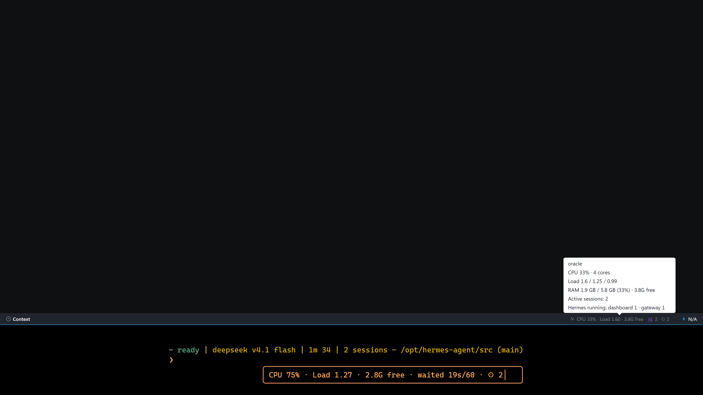

# Hermes Vitals Light

[](https://github.com/atostivint/hermes-vitals-light/actions/workflows/ci.yml)

Hermes **Desktop** and **TUI** plugin. The Desktop status-bar chip shows the CPU, load average, free
RAM, CPU pressure (Linux PSI) and RTT of the server it is connected to:
`CPU 23% · Load 1.20 · 3.8G free · waited 15s/60 · RTT 12 ms · 👥 2 · ⚙ 3`. On a remote gateway (SSH, URL + token) it
measures the remote box, not your PC. Load is the 1-minute average (omitted when the server reports
none); the tooltip adds hostname, cores, 5/15-min load, RAM used / total, free RAM, waited and RTT.



The mockup above reproduces the Desktop status bar with the chip and its tooltip open, and the TUI
card under it. It is a reconstruction of both surfaces, not a screenshot.

`waited 15s/60` is Linux PSI CPU pressure: the seconds of the last minute at least one task was
runnable but stalled waiting for a CPU, computed as `round(avg60 * 0.6)` from the `some` line of
`/proc/pressure/cpu`. It is omitted when PSI is unreadable (macOS, Windows, containers without PSI).
`3.8G free` is `MemAvailable` from `/proc/meminfo` on Linux and psutil's available RAM on macOS and
Windows, in GiB, one decimal. The Linux figures come from one stateless two-file read, with no
psutil, subprocess or cache. If free RAM is unreadable, the chip falls back to the old percentage;
`waited` is simply omitted where the kernel has no PSI.

`RTT 12 ms` is the round trip of a WebSocket `ping` over the Desktop's live gateway socket,
measured in the Desktop half (`host.request('ping')`); it is left out when that socket cannot
answer. It is the connection the app actually uses, not ICMP ping and not the `/stats` request
(whose process scan runs in the background). The TUI has no server to ping, so its card does not
offer it. RTT does not change the chip colour.

The chip colour comes from the waited verdict, not from CPU or load: **red (stuck)** at
`waited >= 25` or less than 1 GiB free, **amber (busy)** at `waited >= 10`, otherwise normal. On
macOS and Windows, where there is no PSI, only the free-RAM rule applies. When a poll fails, the
chip keeps the last figures, dimmed, and its tooltip says how old they are and why; it shows
`CPU —` only when it has never received a reading from the current server.

The first icon is a health light: `pulse` normally, `watch` when the last successful poll took
1.5 s or more, `clock` after a timeout, `debug-disconnect` when the backend is stopped or
unreachable, `plug` when the backend half is missing, and `warning` for another backend error.
The badge itself stays short: the icon carries the state. A stale or unavailable chip gets a
compact two-line tooltip (state title + last-reading/attempt line) instead of the full host/load
detail, so an offline backend does not open a large panel. Healthy polls keep the full tooltip.

`👥 N` is the number of active sessions on the connected server: Hermes's own
`active_sessions` figure from its public `GET /api/status` (sessions not ended and active in
the last 5 minutes, among the 50 most recent, current profile). It is a total, not a count
per client; the tooltip reads `Active sessions: N`. The backend half asks the server it runs
in, over loopback, on the socket address the request arrived on, and keeps the answer for
15 s, refreshed in the background (`/api/status` does much more than count). That needs the
route to run inside the server, which is the default (`plugins.isolation: in_process`): in the
plugin host (`isolation: host`) there is no address to ask and `👥` is left out.

`⚙ N` counts the Hermes executables running on the server right now, all profiles and
users it can see: each `hermes` command (`serve`, `chat`, `gateway`, `dashboard`…),
`hermes-agent`, `hermes-acp`. The tooltip breaks it down by command
(`Hermes running: chat 3 · serve 1`), so several agents launched in parallel show up as
`chat 3`. A Hermes folds into its parent only when that parent is itself Hermes: the Windows
launcher and its python child count once under the launcher, a `tui_gateway` under the `hermes`
that spawned it. The chain has to be contiguous in Hermes processes, so a `hermes serve` that a
shell launched from an agent's terminal — a non-Hermes process in between — counts on its own.
The Desktop app itself (`Hermes`, capitalised) is not counted.

Both background caches can be lengthened on a busy server: `VITALS_STATUS_TTL` (default 15 s)
and `VITALS_PROCESS_TTL` (default 5 s), in seconds, in the backend's environment, so a loaded
box is asked for its session count and process table less often.

**Settings ▸ Plugins ▸ Hermes Vitals Light** has one switch per figure (CPU, Load average, RAM,
Waited on CPU, RTT, Active sessions, Hermes processes), all on by default and saved per Desktop. A
hidden figure is only hidden; the colour still comes from the waited verdict. With everything off
the chip is just its icon. The tooltip shows the full detail of what is measured. Active sessions
and Hermes processes switched off are not measured at all: the chip polls
`/stats?skip=clients,processes` and the server skips the `/api/status` ask and the process scan
(the TUI does the same for its process option). RTT switched off sends no ping.

## TUI

In `hermes --tui` the same figures sit in a card docked above the prompt, coloured like the
chip (the TUI's skin colours), without `👥` or `RTT`: both come from the Desktop's gateway
(`/api/status` and a WebSocket ping), and the TUI has no server to ask. The TUI measures the
machine it runs on: the card runs `plugin_api.py` with the TUI's own Hermes python, which prints
the `/stats` body every 3 s (`/vitals every <s>` changes it) for as long as the card is docked.

| Command | Effect |
|---|---|
| `/vitals` | dock / undock the card |
| `/vitals ram off` | hide a figure: `cpu`, `load`, `ram`, `waited`, `processes` (`on` shows it, no `on`/`off` flips it) |
| `/vitals detail on` | add the Desktop tooltip lines (hostname, cores, 5/15-min load, RAM used / total, free RAM, waited, per-command counts) |
| `/vitals all on` · `all off` | every figure (not `detail`) |
| `/vitals reset` | back to the defaults: every figure on, `detail` off |
| `/vitals help` | usage and the current options |

Several go in one command (`/vitals cpu off load off detail on`); changing an option
docks the card. Options are saved in `<HERMES_HOME>/vitals.json`, shared by every TUI
of that home (the Desktop keeps its own, in Settings ▸ Plugins).

Three halves, one package (same layout as other unified Hermes plugins):

| Half | Where it runs | What it does |
|---|---|---|
| `desktop/plugin.js` | Hermes Desktop (renderer) | Chip in `statusBar.right`; polls `/stats` every 3 s by default (Refresh every), times a gateway `ping` for RTT, skips while the window is hidden, re-polls at once when it becomes visible or on a connection/profile switch. A failed poll keeps the last figures, dimmed. |
| `dashboard/plugin_api.py` | The Hermes backend you connect to | Read-only `GET /api/plugins/hermes-vitals-light/stats` via `psutil` (a Hermes core dependency), a loopback `GET /api/status` on the server it runs in, and, on Linux, one two-file `/proc` read for PSI/free RAM. Returns only load figures, the hostname, the session total, per-command process counts and the waited verdict. Both counts are cached and refreshed in the background, so a request never waits for them. |
| `tui/hermes-vitals-light.mjs` | Hermes TUI (`<HERMES_HOME>/tui-widgets/`) | Ambient widget app `/vitals`; inlines `plugin_api.py` and runs it as a child (`python -c`) for the figures. |

Without the backend half on the server, the chip shows `CPU —` (tooltip explains) and the
poll backs off up to 30 s.

`/stats` is read-only and goes through the backend's usual authentication. It exposes the
hostname, the load figures and the two counts; no session ids, process list, paths or environment.

**What it reads, and where it goes.** The backend half reads psutil's CPU / load / memory figures
(including available RAM), two Linux `/proc` files (PSI and `MemAvailable`) when it runs on Linux,
the process table (pid, parent pid and command line) to count Hermes executables, and the server's
own loopback `GET /api/status` for the session total. Beyond the Desktop/TUI's normal connection to
its Hermes backend, the only network call the plugin makes is that loopback ask; it sends nothing
to a third party and has no telemetry or self-updater. The TUI half runs the same `plugin_api.py`
as a `python -c` child of the TUI, so it reads the machine the TUI runs on.

The dashboard half is API-only: `dashboard/manifest.json` registers a hidden `/vitals` page so the
web dashboard has a bundle to load beside `plugin_api.py`; the visible UI is the Desktop chip and the
TUI card.

## Requirements

- Hermes 0.22 or newer, with Hermes Desktop plugin support (Desktop half) or `hermes --tui`
  (TUI half).
- The backend half needs `psutil` and FastAPI, both already present in a `hermes serve`
  environment; no extra dependency is installed.
- Backend and TUI halves run on Linux, macOS and Windows. `waited` needs Linux PSI; `free` uses
  `MemAvailable` on Linux and psutil's available RAM on macOS/Windows.
- Node.js 20+ is needed only to build from source.

## Install

**Desktop half** (the machine running the Desktop app; it ships off and must be enabled):

- From the catalog: open **Capabilities → Plugins**, find **Hermes Vitals Light**, and install it;
  the app copies `desktop/plugin.js` into `desktop-plugins/`. Then enable it.
- From a source checkout: `node scripts/build.mjs && node scripts/install.mjs --desktop`

**Backend half** (the machine running the backend your Desktop connects to, e.g. over SSH):

```
hermes plugins install hermes-vitals-light --enable       # from the catalog
# or:
hermes plugins install https://github.com/atostivint/hermes-vitals-light --enable
hermes plugins enable hermes-vitals-light                 # user plugins must be in plugins.enabled
# then restart that backend (hermes serve / dashboard)
```

**TUI half** (optional, the machine running `hermes --tui`; it measures that machine):

```
cp ~/.hermes/plugins/hermes-vitals-light/tui/hermes-vitals-light.mjs ~/.hermes/tui-widgets/
# Windows: %LOCALAPPDATA%\hermes\plugins\hermes-vitals-light\tui\hermes-vitals-light.mjs
#          -> %LOCALAPPDATA%\hermes\tui-widgets\
```

The TUI picks the widget up live, no restart. From a source checkout, use
`node scripts/build.mjs && node scripts/install.mjs --tui`.

## Uninstall

- **Desktop**: disable it in **Capabilities → Plugins**, then delete
  `<hermes home>/desktop-plugins/hermes-vitals-light/`.
- **TUI**: delete `<HERMES_HOME>/tui-widgets/hermes-vitals-light.mjs`; remove
  `<HERMES_HOME>/vitals.json` too to drop its saved options.
- **Backend**: `hermes plugins disable hermes-vitals-light`, then restart that backend.

## Footprint

Measured on Windows 11 (10.0.26320), 524 processes, 31.7 GiB RAM, with the Hermes venv python
3.11.16 and psutil 7.2.2, on 2026-11-12. **Working set** is the memory Task Manager shows (the
resident pages); **private bytes** is the commit the process owns alone. They differ by about 10 MB
on this interpreter, so each figure below names which one it is — the previous table did not, which
is how "60 MB" and "43 MB" came to describe the same child.

| What | Cost |
|---|---|
| `/stats` in `hermes serve`, everything on | 0.1 ms per poll (median of 300 here) for a 245-byte body: the load figures and the two counts from their caches. One process scan at most every 5 s and one `/api/status` ask every 15 s, both in the background |
| `/stats?skip=processes` | 0.3 ms per poll (median of 300): the load figures and the cached session total, no scan |
| `/stats?skip=clients,processes` | 0.3 ms per poll: the load figures only, no scan and no `/api/status` ask |
| PSI + free RAM read (Linux) | unmeasured on this machine (Windows): two small `/proc` files, no psutil, subprocess, thread or cache |
| First process scan after a start, before → after | **5.4 s → 22 ms**, then 30 ms → 3 ms for the scans after it. The old first pass asked for every process's parent: 5.17 s of its 5.29 s sat in `psutil_windows.ppid_map`, once per process, with the GIL held on the `hermes serve` event loop. The new pass reads names, then a candidate's argv, and takes one parent snapshot (9.7 ms) only when two Hermes processes could be nested |
| TUI card child (`python -c`), everything on, before → after | **56.8 → 32.2 MB working set**, **43.2 → 22.5 MB private** |
| TUI card child, both counts off, before → after | **57.4 → 31.1 MB working set**, **44.6 → 21.6 MB private** |
| Desktop half | one `GET /stats` per poll (the 245-byte body above), nothing while the window is hidden, one gateway `ping` per poll while it is shown (RTT on) |
| Imports the child no longer pays | FastAPI **+22.8 MB** and `urllib.request` **+4.7 MB** of working set on top of `import psutil`: the child serves no route, so it imports neither |

`npm run footprint` re-measures the interpreter, the backend module and the child rows on the
machine it runs on (Windows and Linux; macOS prints `unavailable` instead of guessing), and
cross-checks the external sampler against the child's own report. The child is sampled through the
real `startFeed` code, so the process measured is the one the TUI spawns. The session count is not
part of these timings: it is one loopback `/api/status` ask every 15 s, run in the background.

The child now spends 0.6 s of CPU in a 15 s run against 7.0 s before, most of the old figure being
that first scan. Timings at this scale are noisy: the gaps between the three `/stats` rows are
noise, one first poll in each run of 300 took about 0.35 s while its pages faulted in, and the rest
stayed under a millisecond.

## Tests

```
node --test test/dashboard.test.mjs test/load.test.mjs test/plugin.test.mjs test/tui.test.mjs  # manifest + Desktop + TUI halves (build first)
python -m unittest discover -s test -p "test_*.py"                           # backend unit
pip install psutil fastapi httpx && python -m unittest discover -s test -p "test_*.py"
                                                                             # also mounts the real FastAPI route
```

CI runs both suites on Linux, macOS and Windows on every push and pull request, and fails if the
committed halves do not match `src/` after `npm run build`.

## Known limits

- The session count is Hermes's `active_sessions`: sessions not ended and active in the last
  5 minutes, among the 50 most recent of the current profile, so it stops at 50 and is not per
  client. It is left out when the route runs in the plugin host, behind a unix socket, or when
  the server's `/api/status` does not answer on its own address (a TLS certificate that does not
  match `127.0.0.1`, for one). It is cached for 15 s and refreshed in the background, so it can
  be up to 15 s old; the first answer after a backend restart can omit it.
- The process count is by command line: a Hermes run some other way (`python -c`, renamed
  script) is not seen, and processes of other users whose command line is unreadable are
  skipped. It includes the `hermes serve` answering the chip. The scan is cached for 5 s, so the
  count can be up to 5 s old; the first answer after a backend restart can omit it.
- A failed poll keeps the last figures (dimmed) and their age in the tooltip; polls back off to
  30 s. `CPU —` appears only when no reading has arrived for the current server. A timeout is
  not treated as a missing backend half (a 404 is). A stopped backend and a dropped SSH
  connection both show `offline`; a backend that is merely too slow shows `timeout`.
- The lag warning is fixed at 1.5 s; it is not a setting. A healthy `/stats` answers well under
  100 ms, so this leaves room for a slow remote link while still flagging a struggling backend.
- RTT is the Desktop↔gateway WebSocket path: it includes the app's own scheduling, and is left
  out when the gateway socket is down or the host has no `host.request`. It is not an ICMP ping,
  and it does not affect the health icon or the chip colour.
- `waited` is Linux-only: it is omitted when `/proc/pressure/cpu` is unreadable (macOS, Windows, or
  a container without PSI). `free` is `MemAvailable` on Linux and psutil's available RAM elsewhere,
  one decimal GiB; the chip falls back to the old RAM percentage only when neither source is
  readable. The chip colour uses the waited verdict and free RAM: `stuck` at 25 waited seconds or
  under 1 GiB free, `busy` at 10 waited seconds, `ok` otherwise.
- Client polls are clamped to at least 0.5 s.
- Load average is native on Linux and macOS; on Windows psutil emulates it, so the first minutes
  after a backend start can read `0.00`. It is display-only and does not affect the chip colour.

- CPU % is measured between two polls (`psutil.cpu_percent(interval=None)`); several windows
  polling the same server share that window, so each sees a shorter sample. It is displayed
  only; the chip colour no longer uses CPU % or load average.
- Verified in the real Hermes Desktop status bar. The backend route is tested against a plain
  FastAPI router and a local stand-in for `/api/status`, not a live `hermes serve`; the TUI card
  is tested against a stub TUI/SDK, not a live `hermes --tui`.
- English-only tooltip and settings; fixed thresholds. The refresh period is a setting
  (Settings ▸ Plugins ▸ Refresh every: 1, 3, 5, 10, 30 or 60 s, default 3 s; `/vitals every 10`
  in the TUI). Hosts older than Settings ▸ Plugins show every figure.
- CPU, load and RAM are always measured (one psutil call each, under 2 ms), and on Linux waited/free
  are one two-file `/proc` read; switching any figure off only hides it.
- TUI: a TUI attached to a remote gateway still shows its own machine. The card's first line
  leaves the process count out and the scan runs in the background, so `⚙ N` appears one line after
  the other figures (the first scan took 22 ms on Windows here, 3 ms for the scans after it).
- TUI: the Desktop and TUI options are separate (the Desktop's live in its local storage).
